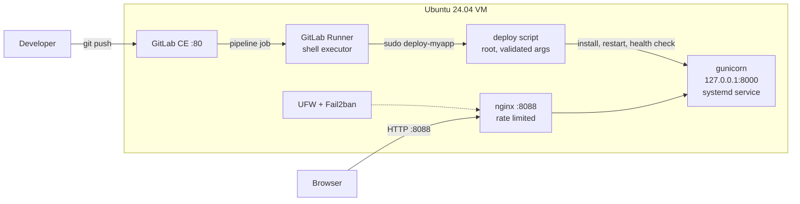

# Secure CI/CD Pipeline: Flask and GitLab on a Hardened Linux Server

A self-hosted delivery pipeline built from scratch: a GitLab CE server and runner on an Ubuntu 24.04 VM that lint, test and deploy a Flask application onto a hardened host, with a health check and automatic rollback.

The application is deliberately small. The project is about the pipeline, the deployment model and the server security around it.

> **Status:** The original environment (a private VM) has been decommissioned. The application, tests and pipeline logic are verified locally, but the provisioning scripts and the systemd and nginx configs in this revision have not been re-applied to a fresh host yet. See [Limitations and roadmap](#limitations-and-roadmap).

## What this demonstrates

- Self-hosted **GitLab CE** with a **shell-executor runner**, installed and configured end to end
- A **lint, test, deploy** pipeline that only deploys from the default branch
- **Least-privilege deployment**: the runner can run exactly one root command, a validated deploy script, through sudo
- **Post-deploy health check with automatic rollback** to the previous release
- **Server hardening**: UFW default-deny firewall, Fail2ban, key-only SSH with root login disabled, automatic security updates
- A **sandboxed systemd service** (gunicorn, non-root user, read-only filesystem) behind an **nginx** reverse proxy with rate limiting
- Scripted provisioning instead of manual setup, with safety checks against locking yourself out of SSH

## Architecture



More detail, the port map and the deployment sequence are in [docs/architecture.md](docs/architecture.md).

## Pipeline

| Stage | Job | What it does |
|-------|-----|--------------|
| lint | `lint` | Runs `flake8` on the application and tests |
| test | `test` | Runs `pytest` and publishes a JUnit report to GitLab |
| deploy | `deploy` | Default branch only. Runs `sudo deploy-myapp`, which validates its inputs, backs up the current release, installs dependencies, swaps the files, restarts the service and polls `/health`. If the check fails it restores the previous release and fails the job |

## Security measures

| Control | Implementation | Where |
|---------|----------------|-------|
| Default-deny firewall | UFW: deny incoming, allow outgoing; SSH rate limited; only 22, 80, 443 and 8088 open | `scripts/provision.sh` |
| Brute-force protection | Fail2ban `sshd` jail and an nginx rate-limit jail | `scripts/provision.sh` |
| SSH hardening | Root login off, password auth off, key only, `MaxAuthTries 3`, validated with `sshd -t` before restart, lockout guard | `scripts/provision.sh` |
| Least-privilege deploys | `gitlab-runner` may only run `/usr/local/bin/deploy-myapp` as root; the script validates path and version arguments | `deploy/deploy-myapp.sh` |
| Service sandboxing | Non-root `myapp` user, read-only filesystem, no new privileges, private tmp and devices, no capabilities | `deploy/myapp.service` |
| Reduced attack surface | gunicorn only listens on localhost; the Flask dev server and port 8080 are no longer exposed | `deploy/`, `scripts/provision.sh` |
| HTTP hardening | Security headers and a strict CSP from the app, `server_tokens off` and per-IP rate limiting in nginx | `app.py`, `deploy/nginx-myapp.conf` |
| Patching | Unattended security updates | `scripts/provision.sh` |

Rationale, the comparison with the original setup, and known gaps are in [docs/security.md](docs/security.md).

## Repository layout

```
.gitlab-ci.yml          Pipeline definition
app.py                  Flask application (app factory, /health, /version)
templates/, static/     Status page
tests/                  pytest suite
deploy/
  deploy-myapp.sh       Root-owned deploy script with validation and rollback
  myapp.service         Hardened systemd unit
  nginx-myapp.conf      Reverse proxy and rate limiting
scripts/
  provision.sh          OS hardening and application runtime
  install_gitlab.sh     GitLab CE and Runner installation
docs/
  architecture.md       Components, ports, deployment flow, design decisions
  security.md           Controls, original vs revised setup, known gaps
  evidence/             Command output captured from the original deployment
```

## Run locally

```bash
python3 -m venv .venv
. .venv/bin/activate
pip install -r requirements-dev.txt

flake8 app.py tests    # lint
pytest                 # tests
python app.py          # dev server on http://127.0.0.1:5000

# or the production server
gunicorn --bind 127.0.0.1:8000 app:app
```

## Reproduce on a VM

Requirements: a fresh Ubuntu 24.04 VM (4 GB RAM is recommended for GitLab) and an admin account with an SSH key.

```bash
git clone <this repository> && cd <this repository>

sudo ./scripts/provision.sh                                         # hardening and app runtime
sudo EXTERNAL_URL=http://<vm-ip> ./scripts/install_gitlab.sh        # GitLab CE and runner packages
```

Then set the GitLab root password, create a project runner in the UI, register it with the shell executor (the install script prints the exact command) and push the repository to GitLab. The first pipeline on the default branch performs the deployment and the application is served on `http://<vm-ip>:8088`.

## Original deployment and evidence

The first version ran on a private VM (4 vCPU, 3.8 GB RAM, Ubuntu 24.04 LTS) with GitLab CE, a shell-executor runner and the Flask app on port 5000. Command output captured from that deployment (UFW rules, Fail2ban jails, SSH settings) is kept in [docs/evidence](docs/evidence/README.md). It documents the original state, which this revision intentionally improves on.

## Limitations and roadmap

Current limitations:

- The revised provisioning scripts, systemd unit and nginx config have not yet been re-applied to a fresh VM
- HTTP only; no TLS on GitLab or the application
- The shell executor runs jobs directly on the host, so the runner is a trusted component
- No automated security scanning in the pipeline yet
- No monitoring, alerting or backups

Planned next, as a second pipeline iteration:

1. **Secret detection** on every commit
2. **SAST** (for example Bandit or Semgrep) and **dependency scanning** (`pip-audit`)
3. **Container build and image scanning** (for example Trivy), replacing the shell-executor deploy with a containerised one
4. **DAST** (OWASP ZAP baseline scan) against a staging deployment, gating promotion to production
5. **Infrastructure as code** (Ansible or Terraform) and IaC scanning
6. **TLS**, monitoring and backups for GitLab
7. SBOM generation and pinned, verified installers

## Background

Built as the practical project for a DevSecOps engineer role application. Everything, from the VM and GitLab installation through runner registration, the pipeline and the hardening, was set up from scratch.
