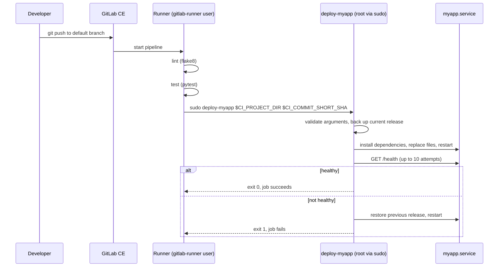

# Architecture

## Components

| Component | Role | Notes |
|-----------|------|-------|
| GitLab CE | Source control and CI/CD orchestration | Bundled nginx owns port 80 |
| GitLab Runner | Executes pipeline jobs | Shell executor, runs as the `gitlab-runner` user on the same host |
| `deploy-myapp` | Performs the deployment | Root-owned script in `/usr/local/bin`, the only command the runner may run through sudo |
| gunicorn + systemd | Runs the Flask app | `myapp.service`, non-root `myapp` user, listens on `127.0.0.1:8000` |
| nginx | Reverse proxy for the app | Listens on `:8088`, rate limits per client IP |
| UFW | Host firewall | Default deny for incoming traffic |
| Fail2ban | Intrusion prevention | `sshd` jail and nginx rate-limit jail |

Everything runs on a single VM. That keeps the lab simple and cheap, and it is also the main architectural limitation (see [security.md](security.md#known-gaps)).

## Ports

| Port | Exposed | Purpose |
|------|---------|---------|
| 22/tcp | Yes, rate limited | SSH, key authentication only |
| 80/tcp | Yes | GitLab (HTTP) |
| 443/tcp | Yes | GitLab (HTTPS), reserved for when TLS is configured |
| 8088/tcp | Yes | Application via nginx |
| 8000/tcp | No, localhost only | gunicorn |

The original setup also exposed 5000 (Flask development server) and 8080. Both are closed in this revision.

The app is published on 8088 rather than 80 because GitLab's bundled nginx already uses port 80 on the same host. 8080 was avoided on purpose, as it is a common internal port for GitLab components.

## Deployment flow

Application files are installed under `/opt/myapp/current`, owned by root, so the service user cannot modify its own code. The previous release is kept in `/opt/myapp/previous` for one-step rollback. The deployed commit SHA is exposed at `/version`.

## Design decisions

**One privileged script instead of broad sudo.** The original deploy job ran several `sudo` commands. A runner that can run arbitrary commands as root turns any compromised pipeline into a compromised server. Restricting sudo to a single script that validates its inputs (source path must be under the runner's build directory, version must match a strict pattern) shrinks that blast radius. It does not eliminate it, because the shell executor still runs untrusted job code as the runner user.

**systemd instead of `nohup`.** The original deploy started the app with `sudo nohup python3 app.py &` and killed it with `pkill`. A systemd unit gives restart on failure, logging through the journal, a non-root user and kernel-level sandboxing options.

**gunicorn instead of the Flask development server.** The development server is not intended for production use and was listening on all interfaces.

**nginx in front of the app.** Keeps the application on localhost, adds rate limiting and gives a place to add TLS later.

**Health check with rollback.** A deploy that "succeeds" because the commands ran, but leaves a broken service, is a false positive. The job succeeds only if `/health` answers after the restart.

**Provisioning as code.** Hardening is applied by a script that validates SSH configuration before restarting the daemon and refuses to disable password login unless a key is present, so it cannot lock out the administrator.
